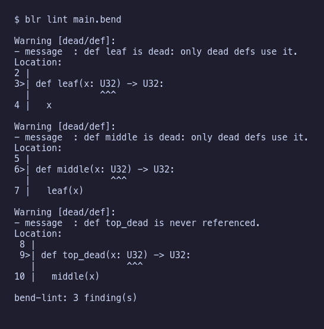

# bend-lint-rules

Find dead defs, over-complex defs and tangled call graphs in a Bend 2 program, as extra rules for the official `bend-lint`.



Code-quality lint rules for [Bend 2](https://github.com/bendlang/bend), written in Bend, for the
official linter that ships in the Bend repo: [`tools/bend-lint`](https://github.com/bendlang/bend/tree/v2.0.38/tools/bend-lint).

| rule | what it reports | options (default) |
| --- | --- | --- |
| `dead/def` | a def that no entry point reaches (entry points: `main`, laws and their proofs, the `entries` option) | `entries` (`""`), `imports` (`false`) |
| `complexity/cyclomatic` | a def with more independent paths than `max` | `max` (10) |
| `complexity/cognitive` | a def whose nested `match`es read harder than `max` | `max` (15) |
| `graph/fan_out` | a def that uses more than `max` different defs | `max` (10), `imports` (`false`) |
| `graph/fan_in` | a def used by more than `max` different defs | `max` (20), `imports` (`false`) |
| `style/file-length` | a file longer than `maxLines` (**upstream's own rule**, enabled in this pack's config) | `maxLines` (500) |

There is no `size/file_length` here: upstream already ships `style/file-length`
(`tools/bend-lint/rules/file_length.bend`), so [`bend-lint.json`](bend-lint.json) turns that one on and
`blr lint` ([`src/lint.rs`](src/lint.rs)) loads it with the rest.

## Install

You need [Bun](https://bun.sh) 1.2 or newer, [Bend](https://github.com/bendlang/bend) 2.0.38 on `PATH`
(`bend version` must print the line in [`.bend-version`](.bend-version)), `git`, a Rust toolchain (the
setup, fixture runner and lint wrapper are one small std-only crate, `blr`), and
[`just`](https://github.com/casey/just) for the recipes. No clang is needed: Bend rules run on Bend's
JavaScript runtime.

```sh
git clone git@github.com:davidawad/bend-lint-rules.git
cd bend-lint-rules
just setup     # clones bendlang/bend at the pinned tag into upstream/bend (gitignored, verified by commit)
```

`bend-lint` is not on npm: it lives in the Bend repo and is run from a checkout of it. `just setup` makes
that checkout. The pin is [`upstream.env`](upstream.env) (tag `v2.0.38`, commit
`0a57ca0d21de94a3724d8be21afb0eb89f88b4d8`); `blr setup` ([`src/setup.rs`](src/setup.rs)) fails if the tag has moved.
Every rule imports the rule API from a vendored copy in `rules/vendor/`; the checkout is what runs bend-lint itself.

## Use

```sh
cargo run --quiet -- lint path/to/main.bend         # all rules of this pack, plus style/file-length
cargo run --quiet -- lint path/to/main.bend --json  # any bend-lint flag
```

Or call bend-lint yourself and pick rules with `--rules`:

```sh
bun upstream/bend/tools/bend-lint/src/lint.ts main.bend \
  --rules /path/to/bend-lint-rules/rules/dead/def.bend \
  --rules /path/to/bend-lint-rules/rules/complexity/cyclomatic.bend
```

bend-lint lints **one file and what it imports**. Lint your program's entry file. Findings go to stdout;
the exit code is 0 for no errors (warnings do not count), 1 for an error finding or a file that does not
check, and 2 for a bad command line.

### Config

Options and severity come from the nearest `bend-lint.json` above the file, or from `--config <file>`.
Copy [`bend-lint.json`](bend-lint.json) next to your code and edit it:

```json
{
  "rules": {
    "style/file-length": { "maxLines": 500, "severity": "warning" },
    "dead/def": { "severity": "warning", "entries": "api.*, handle_request" },
    "complexity/cyclomatic": { "max": 10, "severity": "warning" },
    "complexity/cognitive": { "max": 15, "severity": "warning" },
    "graph/fan_out": { "max": 10, "severity": "warning" },
    "graph/fan_in": { "max": 20, "severity": "warning" }
  }
}
```

- `"severity"` is `error`, `warning`, `information` or `hint`; `"off"` instead of an object turns a rule off.
  It replaces the severity the rule reports with, including its hint.
- An `error` finding ends the run: bend-lint drops the rest of that rule's findings and every later rule.
  Use `warning` to see all findings, `error` to fail CI.
- Numbers are whole numbers from 0 to 4294967295.
- Bend's checker runs first. A file that does not check gives one `bend/check` error and no rule runs.

## Rules

### `dead/def`

A def is live if an entry point reaches it through references, in bodies or in types. The entry points are

- `main`;
- every law, and the def that proves it (in the same file or, as `def Laws.name(..)`, in another): laws are
  specs, so what they mention is live;
- the names in the `entries` option.

Everything else is dead, including a chain of defs that only call each other (the head reads "never
referenced", the rest "only dead defs use it") and a def that only calls itself.

Bend has no export keyword, so a def meant for outside callers (a library's API, a def a JavaScript host
calls) goes in `entries`: a comma-separated list; `name*` is a prefix; a name matches with or without its
file's namespace (`helper` or `util:helper`); `*` makes every def an entry (use it for a library file).

By default only defs in the linted file are reported. Set `"imports": true` to report the defs of every
local file the program imports too (do this when the imports are your own modules and the linted file is
the whole application). Not reported: types and constructors, foreign-effect defs (they have no checked
body), and hub packages. With no `main`, no law and no `entries`, there is nothing to measure from, so the
rule says so in one hint instead of calling everything dead.

Template calls (`twice(~inc, x)`) count as uses of the template, and `~inc` as a use of `inc`.

### `complexity/cyclomatic`

`1 + decisions`. Bend checks a `match` into one `Mat` node per tested constructor and closes an exhaustive
match with an `Efq` node; the closing test decides nothing, so complexity is `1 + Mat - Efq`. Three arms
give 3; two arms and a `_` give 3; taking apart a one-constructor type gives 1. A match on several values
at once (`match a b:`) is checked as nested tests and counts as such. Only the linted file's defs are
measured.

### `complexity/cognitive`

After SonarSource's cognitive complexity, with Bend's one branch, `match`: each match adds 1 plus its
nesting depth (the number of matches it sits inside, in an arm body or in the `_` arm). The arms of one
match do not nest in each other, so a flat match of any width scores 1. A match on several values at once
scores as nested tests. Only the linted file's defs are measured.

### `graph/fan_out`, `graph/fan_in`

Fan-out is the number of different program defs a def references; fan-in is the number of different
program defs that reference it. Repeats, self-references, Base, hub packages, types, constructors, laws and
their proofs are not counted. The graph covers the linted file and its imports; `imports` widens which
defs are *reported*, not which are counted.

## Tests

```sh
just test                    # every fixture case
just test dead/def           # one rule
just test dead/def/pass_basic
just self                    # lint this repo's own rules with the pack; all must come out clean
just check-versions          # bend and bun versions
just ci                      # check-versions, setup, test, self
```

`blr test` ([`src/fixtures.rs`](src/fixtures.rs)) runs bend-lint on each case in `fixtures/<group>/<rule>/<case>/` and checks its exit code
and output against the case's `expect` file (format at the top of `src/fixtures.rs`). Each rule has passing
and failing cases: boundaries (`max` met exactly), default limits, imports, laws, templates and options.

`just ci` fails when `bend version` differs from `.bend-version`. Bend has changed between 2.0.x
releases in ways that break tools (2.0.37 and 2.0.38 each broke some), so a new Bend is adopted by running
the tests on it and then editing `.bend-version` and `upstream.env` together.

## Writing rules in Bend: what cost iterations

- Variables are affine: write `+name` to use one twice (parameters, pattern fields, `+x : T <- ...` binds).
- A def may only call defs written above it; recursion between defs needs `@unsafe` on the first (the
  tree walks and the reachability fixpoint do this, as upstream's `fold_facts` does).
- `match` cannot scrutinize a computed value: pass it to a helper def.
- Arguments are evaluated before a call: `Bool.pick(T, c, expensive(), x)` runs `expensive()` always. Use
  a `match` on the Bool. (Splitting Base's text into lines this way overflowed the stack.)
- A rule file defines `id`, `facts`, `run` and `main`, and `main` is `Lint.serve(run)`. `id` and `facts`
  are called by the host, so linting a rule file with `dead/def` needs `"entries": "id, facts"`
  (see `rules/bend-lint.json`).

## BendHub

Published on BendHub as `bend-lint-pack@0.1.1.0` (hash `0x7294c9a1db4be6346e88202032984e02`):
`import bend-lint-pack@0.1.1.0/all.bend as All`
([hub page](https://hub.bend-lang.com/0x7294c9a1db4be6346e88202032984e02)). The BendHub name differs from
this repo's name because `bend-lint-rules` is already owned by another BendHub account.
The package entry is `rules/all.bend`, which imports all five rules. It carries a vendored copy of
bend-lint's rule API (`rules/vendor/`), so the package does not need the `upstream/` checkout.
There is no pull request upstream.

## License

GPL-3.0-or-later, see [LICENSE](LICENSE). The rule API in `rules/vendor/` (`lint.bend`, `effects.js`) is copied
unmodified from Bend v2.0.38 and stays Apache-2.0 (see `rules/vendor/LICENSE-APACHE-2.0`), which is compatible with
GPL-3.0. The rest of Bend and `bend-lint` is not copied: `upstream/` is a checkout made by `just setup`, used to run the tests.

## Showcase

The screenshot above is regenerated by [`docs/showcase/make-screenshots.sh`](docs/showcase/make-screenshots.sh); see [`docs/showcase.md`](docs/showcase.md).
